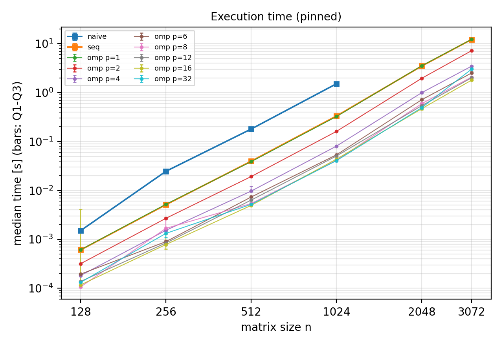
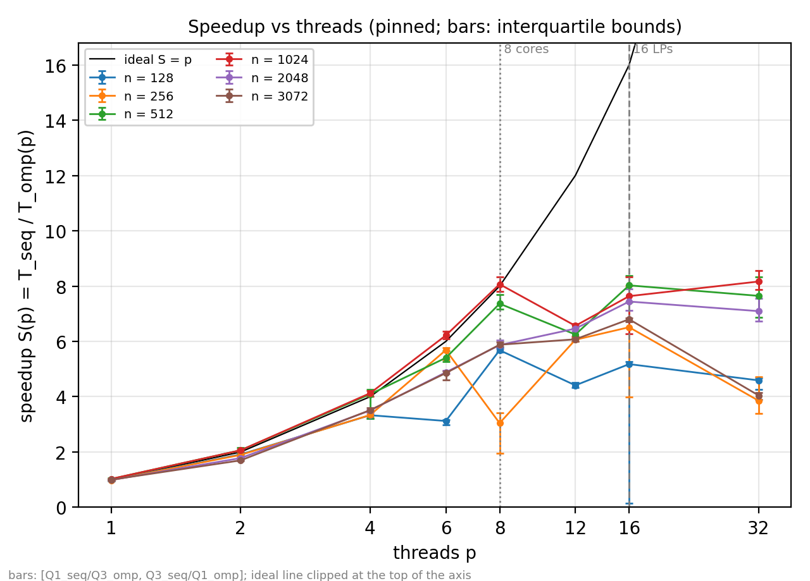
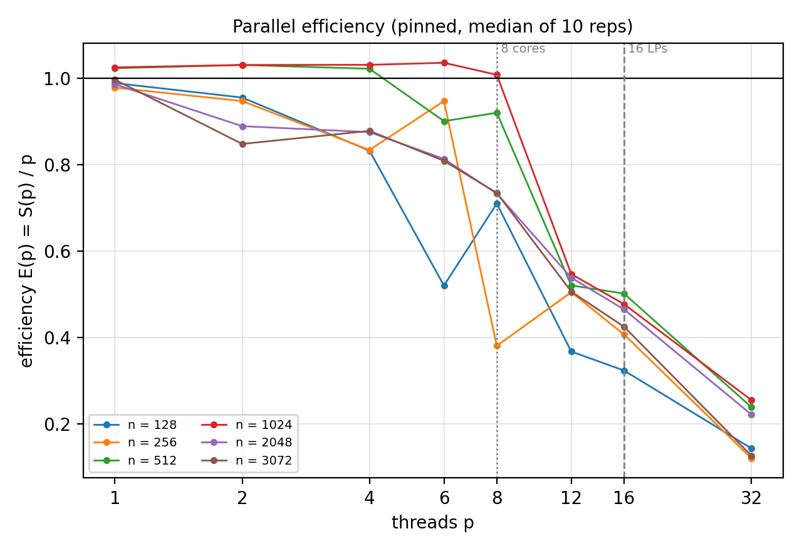
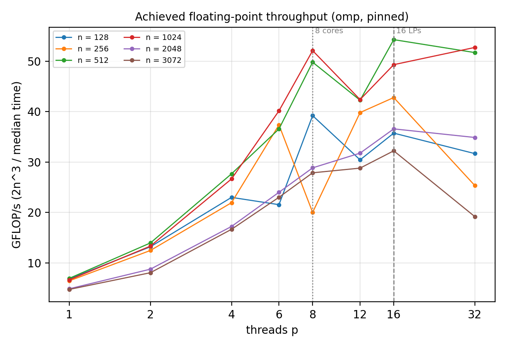
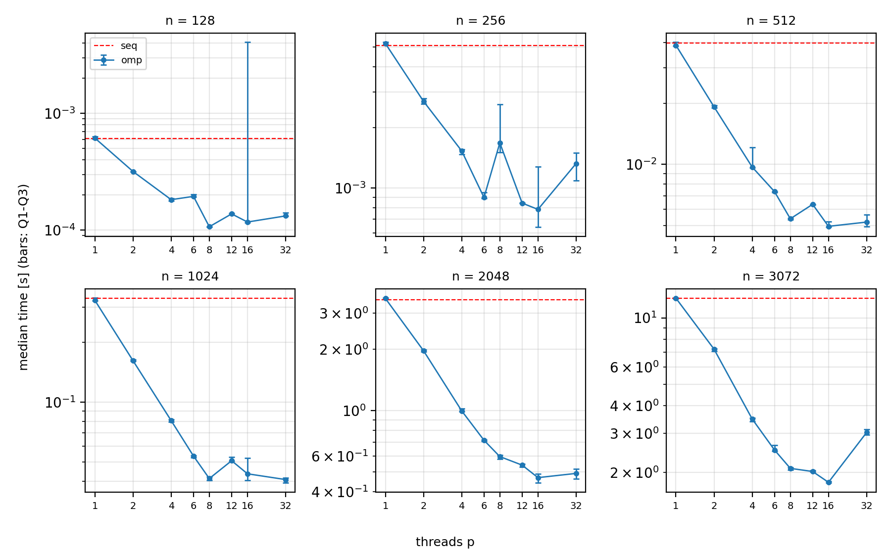
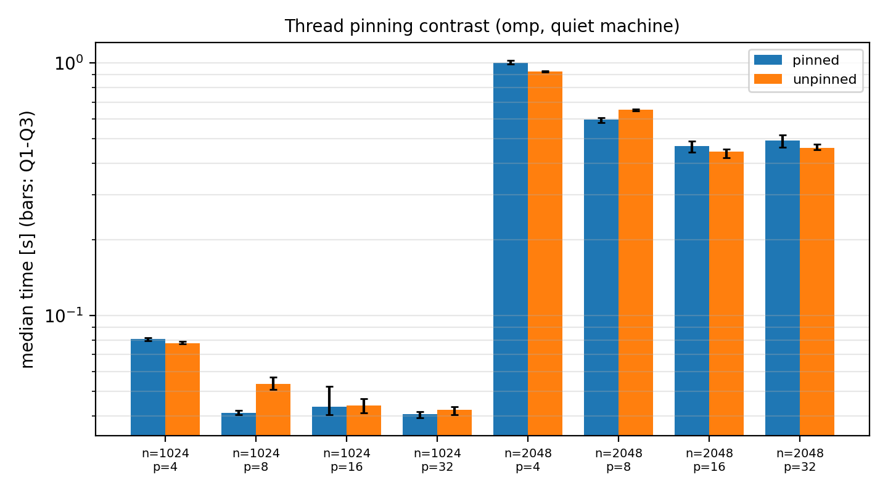
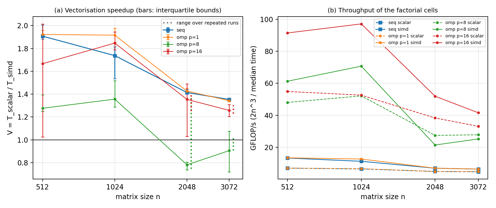

# Parallel Matrix Multiplication and Optional Vectorisation

**Big Data – Assignment 3**

**Author:** Javier Martin Rodriguez — **Date:** November 2026

---

## Abstract

We measure how the number of OpenMP threads `p` affects the run time of a dense,
shared-memory, double-precision matrix multiplication `C = A·B` on an 8-core /
16-thread Intel Core i7-10700K, and determine when parallelisation pays off. A
cache-friendly i-k-j kernel is parallelised over rows of C with a static
schedule; sizes n = 128 to 3072 and p = 1 to 32 are measured with two warm-ups
and ten repetitions per configuration, randomised order and explicit thread
pinning. Parallelisation pays off from p = 2 for every size tested
(n ≥ 128). Up to 8 threads (one per physical core) the speedup is close to
linear while the working set is moderate (n ≤ 1024; S(8) = 8.07 at n = 1024,
where the three matrices take 24 MiB, more than the 16 MiB L3, but B alone,
8 MiB, fits), and drops to S(8) ≈ 5.9 for n ≥ 2048. Hyper-threading
changes throughput by −5 % to +9 % for n = 512–1024 and adds 16–27 % for
n ≥ 2048; 12 threads are slower than 8 for n = 128, 512 and 1024 (n = 256 is
excluded because of an anomalous S(8)), consistent with the static row
partition over unevenly shared cores; 32 threads (oversubscription) bring no
significant benefit and are up to 69 % slower than 16. In an optional 2×2 factorial, AVX2 auto-vectorisation
speeds up the sequential kernel 1.35–1.91× and, combined with threading,
reaches a speedup of 15.0 over the scalar sequential code (n = 1024, p = 16).

---

## 1. Research question

> How does the number of threads `p` affect the performance of dense
> shared-memory matrix multiplication, and when does parallelising pay off?

Sub-questions:

1. How do speedup `S(p)` and efficiency `E(p)` depend on `p` and on the matrix
   size `n`?
2. What does the OpenMP machinery cost when it brings no parallelism (`p = 1`)?
3. What happens beyond the number of physical cores: simultaneous
   multithreading (SMT, `p = 16`), unbalanced thread counts (`p = 12`) and
   oversubscription (`p = 32`)?
4. Does pinning threads to processors matter?
5. (Optional) How does SIMD vectorisation interact with threading?

## 2. Background

Dense matrix multiplication performs `2n³` floating-point operations on `3n²`
values, so its arithmetic intensity grows with `n` and, with a good loop order,
it can be compute-bound [2], [5]. In practice the achieved intensity depends on
reuse in the cache hierarchy: the i-k-j order streams through rows of B and C
with unit stride, but a full row-panel of B is reused only if it stays in cache
[6], [8], [12]. Amdahl's law bounds the speedup by the serial fraction [3],
and Gustafson's scaled-speedup view explains why larger problems usually
parallelise better [4]; here the parallel region covers the whole kernel, so
the practical limits are
synchronisation and scheduling overheads, load imbalance, and shared resources
(memory bandwidth, shared L3, the two SMT threads of a core sharing its
execution units) [2], [5]. OpenMP's `schedule(static)` splits the iteration
space into `p` contiguous chunks of approximately equal size, decided before
execution [1];
it is optimal only if every thread progresses at the same rate.

## 3. Hypotheses

The hypotheses below follow from the hardware description
(`results/environment.txt`) and the background above, and are stated before
the results. For transparency: a short smoke test of the benchmark harness
(3 repetitions, n ≤ 1024, `results/raw/bench_quick_smoke.csv`) had already
shown a dip at p = 12 before the main sweep, which motivated H5.

| ID | Hypothesis | Reasoning |
|---|---|---|
| H1 | For medium sizes whose data are largely cache-resident (n ≤ 1024: the three matrices fit in the 16 MiB L3 for n ≤ 512; at n = 1024 only B, 8 MiB, fits), `S(p) ≈ p` up to `p = 8`. | Each thread has its own core, L1 and L2; rows of C are independent and of equal cost. |
| H2 | For small n, fork/join overhead limits the speedup; below some size parallelising does not pay off. | A parallel region costs microseconds; at n = 128 the whole kernel takes well under a millisecond. |
| H3 | For large n (n ≥ 2048, 96 MiB or more), efficiency drops because the kernel becomes limited by memory bandwidth. | All threads stream B from DRAM through the shared memory controller [5]. |
| H4 | `p = 16` (SMT) gives at most a modest gain over `p = 8`; the gain is larger when the kernel is memory-bound. | Two hardware threads share one core's floating-point units; SMT mainly hides latency [2], [10]. |
| H5 | `p = 12` is no better than `p = 8` for compute-bound sizes. | With a static schedule, the 4 threads that share a core with another thread take about twice as long, and everyone waits for them. |
| H6 | `p = 32` (2× oversubscription) is slower than `p = 16`. | Context switches and time slicing of two threads per logical processor; static chunks wait for preempted threads. |
| H7 | `T_omp(1) / T_seq ≈ 1`. | The same kernel body is used; a single-thread parallel region adds a negligible constant cost. |
| H8 | Pinning makes only a small and configuration-dependent difference on an otherwise idle machine. | The Windows scheduler tends to keep compute threads in place when there is no competition. |
| H9 (optional) | AVX2 (4 doubles per instruction) speeds up the sequential kernel by less than 4×, and the gain shrinks for large n and many threads. | The inner loop does two loads and one store per two flops, so it is limited by data movement before it reaches the arithmetic peak [5], [10]. |

## 4. Method

### 4.1 Platform

| Item | Value |
|---|---|
| CPU | Intel Core i7-10700K, 8 cores / 16 logical processors, 3.8 GHz base |
| Caches | L1d 32 KiB and L2 256 KiB per core (shared by its 2 SMT threads), L3 16 MiB shared |
| Memory | 15.85 GiB |
| OS | Windows 11 Pro 10.0.26300, "High performance" power plan |
| Compiler | GCC 14.2.0 (MSYS2 UCRT64), OpenMP 4.5 (libgomp), statically linked |
| Flags (main) | `-O3 -fno-tree-vectorize -std=c11` (no `-march`) |

Full details are in `results/environment.txt`. Matrix footprints: one n×n
matrix of doubles takes 2 MiB at n = 512, 8 MiB at n = 1024, 32 MiB at n = 2048
and 72 MiB at n = 3072, so the three matrices (6, 24, 96 and 216 MiB) fit in
L3 only up to n = 512; at n = 1024 a single matrix (B) still fits.

### 4.2 Implementation

- `matmul_seq`: i-k-j loop order over contiguous row-major arrays; for each row
  i, `C[i][:]` is zeroed and updated with `A[i][k]·B[k][:]` (unit-stride inner
  loop).
- `matmul_omp`: the same row function (shared `static inline` code) under
  `#pragma omp parallel for schedule(static)` over rows of C. Each thread writes
  a disjoint block of rows; A and B are read-only, so there are no races and no
  reductions.
- `matmul_naive`: textbook i-j-k with a scalar accumulator (stride-n access to
  B), measured up to n = 1024 as a contrast.
- Main flags disable auto-vectorisation so that the thread study is not mixed
  with SIMD effects; the optional part (Section 5.7) re-enables it.

### 4.3 Correctness

`src/test.c` checks hand-computed cases, identity and zero matrices, and random
matrices (n = 1, 7, 64, 100, 257) against a long-double reference with
`rtol = atol = 1e-12`, for the sequential, naive and OpenMP kernels with
p = 1, 2, 3, 4, 8, 16, 32: 150 checks, 0 failures, and the OpenMP result is
bitwise identical to the sequential one for every n and p
(`results/correctness/test_output.txt`). An independent check against numpy
with single-threaded OpenBLAS passes for n = 64, 257, 512, with maximum
relative errors between 4.4·10⁻¹⁶ and 3.0·10⁻¹⁵
(`results/correctness/validate_ref.txt`). ThreadSanitizer is not available for
MinGW-w64 (`results/correctness/tsan_unavailable.txt`); the absence of races
rests on the disjoint-rows design and the bitwise equality above.

### 4.4 Measurement protocol

- Only the kernel call is timed (`QueryPerformanceCounter`); inputs are
  generated (SplitMix64, fixed seed) and memory is allocated and touched
  before timing, and a checksum of C is computed after every repetition,
  outside the timed region.
- 2 warm-ups (recorded and flagged) + 10 measured repetitions per
  configuration; following common recommendations for reporting parallel
  performance [7], we report the **median** and the interquartile range (IQR)
  rather than the mean or the best time.
  Speedup bounds use `[Q1_seq/Q3_omp, Q3_seq/Q1_omp]`.
- `OMP_DYNAMIC=false`, `OMP_NUM_THREADS=p`; the team size is checked before
  every repetition (all rows: `p_actual = p`).
- libgomp ignores `OMP_PROC_BIND`/`OMP_PLACES` on Windows, so the benchmark
  pins thread t with `SetThreadAffinityMask` [11] to one logical processor per
  physical core first (0, 2, …, 14) and then to the SMT siblings (1, 3, …, 15);
  the pinning is verified before every repetition.
- Sizes n ∈ {128, 256, 512, 1024, 2048, 3072}, p ∈ {1, 2, 4, 6, 8, 12, 16, 32};
  n in ascending order, (method, p) shuffled within each n with a recorded seed.
  Budgets: 300 s per repetition and 2 GiB of matrices (neither was reached).
- Interactive background applications (web browser, mail, music player) were
  closed; Claude Code, VS Code and other resident applications and utilities
  remained running (2.47
  CPU-seconds per 5 s, `results/raw/background_load_quiet.txt`). A first
  attempt with the interactive applications running is kept as
  `results/raw/bench_full.csv` but not used (Section 7).
- Every row of every run is kept; `scripts/analyze.py` lists anomalous rows
  (none in the data reported here) and checks that all methods and thread
  counts give the same checksum for each n (they do).

Primary data: `results/raw/bench_full_quiet.csv` (580 measured rows). All
values below come from `results/tables/`, generated by `scripts/analyze.py`.

## 5. Results

### 5.1 Execution time

*Figure 1. Median time vs n (log–log); bars Q1–Q3.*

The sequential kernel runs at 6.46–6.90 GFLOP/s for n ≤ 1024 and drops to
4.91 GFLOP/s at n = 2048 and 4.74 GFLOP/s at n = 3072
(`stats_per_config`). The naive i-j-k kernel is 2.48× (n = 128) to 4.82×
(n = 256) slower than i-k-j (`naive_vs_seq`), achieving only 1.36–2.78 GFLOP/s.

### 5.2 Speedup and efficiency

*Figure 2. S(p) = T_seq / T_omp(p); bars are the interquartile bounds.*

Table 1. Speedup S(p) (medians; `results/tables/speedup_matrix`).

| n | p=1 | p=2 | p=4 | p=6 | p=8 | p=12 | p=16 | p=32 |
|---|---|---|---|---|---|---|---|---|
| 128 | 0.99 | 1.91 | 3.33 | 3.12 | 5.68 | 4.41 | 5.18 | 4.59 |
| 256 | 0.98 | 1.90 | 3.34 | 5.69 | 3.05 | 6.06 | 6.51 | 3.86 |
| 512 | 1.02 | 2.06 | 4.09 | 5.41 | 7.36 | 6.25 | 8.03 | 7.65 |
| 1024 | 1.03 | 2.06 | 4.13 | 6.22 | 8.07 | 6.56 | 7.64 | 8.17 |
| 2048 | 0.99 | 1.78 | 3.50 | 4.88 | 5.87 | 6.46 | 7.44 | 7.09 |
| 3072 | 1.00 | 1.70 | 3.51 | 4.86 | 5.88 | 6.08 | 6.80 | 4.05 |

*Figure 3. Efficiency E(p) = S(p)/p.*

- **n = 512 and 1024, p ≤ 8.** Efficiency stays between 0.90 and 1.04. At
  n = 1024 the speedup is slightly above p for p = 2, 4, 6 (2.06, 4.13, 6.22),
  with the lower interquartile bound also above p (2.01, 4.02, 6.09), and
  S(8) = 8.07 [7.81, 8.33].
- **n ≥ 2048.** E(8) = 0.734 (n = 2048) and 0.735 (n = 3072); the best speedups
  are 7.44 and 6.80, both at p = 16.
- **Small n.** At n = 128 the best speedup is 5.68 (p = 8); at n = 256 the
  curve is irregular (S(8) = 3.05 < S(6) = 5.69) and several configurations
  have IQR/median > 0.10 (`flags`).

Table 2. Where parallelism pays off (`parallel_payoff`).

| n | smallest p with S > 1 (lower bound) | best p | best S | E at best p | smallest p within 90 % of best |
|---|---|---|---|---|---|
| 128 | 2 | 8 | 5.68 | 0.71 | 8 |
| 256 | 2 | 16 | 6.51 | 0.41 | 12 |
| 512 | 2 | 16 | 8.03 | 0.50 | 8 |
| 1024 | 2 | 32 | 8.17 | 0.26 | 8 |
| 2048 | 2 | 16 | 7.44 | 0.47 | 16 |
| 3072 | 2 | 16 | 6.80 | 0.43 | 16 |

At n = 1024 the nominal best p = 32 (S = 8.17, interquartile bounds
[7.88, 8.56]) is not significantly better than p = 8 (S = 8.07, [7.81, 8.33])
(`speedup_efficiency`).

*Figure 4. Achieved throughput of the OpenMP kernel.*

The highest throughput is 54.3 GFLOP/s (n = 512, p = 16) and 52.7 GFLOP/s
(n = 1024, p = 32); at n = 3072 the maximum is 32.2 GFLOP/s (p = 16).

### 5.3 OpenMP overhead at p = 1

Table 3. `T_omp(1) / T_seq` (`omp_overhead`).

| n | 128 | 256 | 512 | 1024 | 2048 | 3072 |
|---|---|---|---|---|---|---|
| ratio | 1.011 | 1.022 | 0.977 | 0.975 | 1.014 | 1.003 |
| IQR range includes 1 | yes | no | yes | yes | no | yes |

The ratio stays within ±2.5 %; only n = 256 (+2.2 %) and n = 2048 (+1.4 %) are
above 1 by more than the interquartile spread.

### 5.4 Beyond the physical cores: p = 12, 16 and 32

*Figure 5. Median OpenMP time vs p for each n; the dashed line is the sequential time.*

- **p = 12 vs p = 8.** For n = 128, 512 and 1024, 12 threads are slower than 8: S(12)/S(8) =
  0.776 (n = 128), 0.849 (n = 512), 0.814 (n = 1024); the measured S(12) at
  n = 512 and 1024 is 6.25 and 6.56. For n ≥ 2048 the order is reversed
  (1.101 at n = 2048, 1.033 at n = 3072).
  At n = 256, S(8) is itself anomalously low (3.05, flagged high dispersion),
  so the ratio there (1.99) is not informative.
- **p = 16 vs p = 8.** T(8)/T(16) is 1.090 (n = 512), 0.947 (n = 1024), 1.268
  (n = 2048) and 1.157 (n = 3072); at the small sizes it is 0.911 (n = 128) and
  2.139 (n = 256, again driven by the low S(8)).
- **p = 32 vs p = 16.** At n = 3072, p = 32 takes 3.026 s against 1.800 s
  (S = 4.05 vs 6.80). T(16)/T(32) is 0.592 at n = 256 (p = 32 69 % slower),
  0.886 at n = 128, 0.953 at n = 512 and n = 2048, and 1.069 at n = 1024
  (p = 32 marginally faster).

### 5.5 Thread pinning

*Figure 6. Pinned (cores) vs unpinned medians, bars Q1–Q3.*

On the quiet machine (`pinning_contrast`; unpinned data in
`bench_unpinned_quiet.csv`), the ratio unpinned/pinned ranges from 0.926
(n = 2048, p = 4: unpinned 7.4 % faster) to 1.303 (n = 1024, p = 8: unpinned
30 % slower). Unpinned was faster in 4 of the 8 configurations and slower in
the other 4.

### 5.6 Memory

Peak working set divided by the theoretical `3·8·n²` bytes is 1.05–1.06 at
n = 2048 and 1.02–1.03 at n = 3072 across methods and thread counts; at small n
the ratio is dominated by the fixed process footprint (14.5 for the sequential
kernel at n = 128) (`stats_per_config`).

### 5.7 Optional: vectorisation × threading

A second build, `-O3 -march=native` (`build/simd`), enables gcc's
auto-vectoriser for the host ISA (Skylake: AVX2 and FMA, no AVX-512). The
evidence in `results/vectorisation_evidence/summary.txt` shows that:

- only the simd build vectorises the inner j loop (`src/matmul.h:42`, "loop
  vectorized using 32 byte vectors"), with `vmulpd`/`vaddpd` on `ymm`
  registers; the scalar build contains only `mulsd`/`addsd`;
- the simd objects contain 0 FMA instructions (gcc does not contract `a*b+c`
  in ISO C mode [9]), and the products of both builds are bitwise identical
  (SHA-256 of the dumped C for n = 257, 512, 1024);
- the simd build passes the same 150 tests and the numpy validation.

The 2×2 factorial {scalar, simd} × {seq, omp(p)} was measured back to back on
the quiet machine (`bench_simd_quiet2.csv`, `bench_scalar_ctrl_quiet2.csv`;
the scalar control reproduces `full_quiet` within −6 % to +5 %). `V = T_scalar
/ T_simd`; `S_comb = T_seq,scalar / T_omp,simd(p)`.

*Figure 7. (a) Vectorisation speedup V vs n (bars: interquartile bounds;
dotted: range over repeated runs). (b) Throughput of the factorial cells.*

Table 4. Vectorisation factorial (`vectorisation_factorial`).

| n | V (seq) | V (omp p=8) | V (omp p=16) | S_comb (p=16) | GFLOP/s omp p=16 scalar → simd |
|---|---|---|---|---|---|
| 512 | 1.91 | 1.28 | 1.67 | 13.14 | 54.9 → 91.5 |
| 1024 | 1.74 | 1.36 | 1.85 | 15.03 | 52.6 → 97.1 |
| 2048 | 1.41 | 0.78\* | 1.35 | 10.63 | 38.3 → 51.9 |
| 3072 | 1.35 | 0.91\* | 1.26 | 8.85 | 33.1 → 41.6 |

\* Not reproducible (`unstable_across_runs`). In the factorial run, omp
n = 2048 p = 8 took 0.802 s with the simd build against 0.627 s with the scalar
one. Re-measuring both builds twice, alternated, gave 0.555 s and 0.452 s
(simd) against 0.624 s and 0.597 s (scalar) (`vectorisation_reproducibility`).
Over all runs, V ranges from 0.74 to 1.39 at n = 2048 and from 0.91 to 1.02 at
n = 3072 for p = 8; for p = 16 it stays between 1.23 and 1.41.

## 6. Discussion

**H1 (near-linear speedup up to the physical cores for cache-resident sizes) —
supported.** At n = 512 and 1024, E(p) ≥ 0.90 for p ≤ 8 and S(8) = 8.07 at
n = 1024. The small but consistent excess over p at n = 1024 (lower bounds
above p for p = 2, 4, 6) is compatible with a cache effect: each thread
streams only n/p rows of A and C through its private L1/L2, and B (8 MiB) can
stay in the 16 MiB L3 [8], [12]. All-core turbo is normally lower than
single-core turbo, which would push the other way, so the frequency is
unlikely to explain it. We did not measure cache misses or clock frequency, so
this explanation remains a hypothesis.

**H2 (overhead makes small n not worth parallelising) — refuted for the sizes
tested.** Even at n = 128 (0.61 ms sequential), p = 2 gives S = 1.91 with a
lower bound of 1.89, and the best speedup is 5.68. The fork/join cost is
therefore well below 0.1 ms on this system. Small sizes do show lower
efficiency and much more variability: at n = 128, p = 16 the slowest
repetition took 238× the fastest (IQR/median 33.7). A plausible explanation
(not measured) is that, with all 16 logical processors in use, any background
activity preempts a pinned thread for a scheduler time slice that is much
longer than the kernel. The break-even
point lies below n = 128 and was not located.

**H3 (memory-bound large sizes) — consistent with the data (bandwidth was not
measured).** When not even B fits in L3 (n ≥ 2048), the sequential throughput
falls by about 25 % (6.46 → 4.91 GFLOP/s), E(8) falls from 1.01 to 0.73, and
the gain from more threads flattens (S(16) = 7.44 and 6.80). This is the
behaviour the roofline model predicts when threads share the memory
bandwidth [5]. The i-k-j kernel
has no cache blocking; a blocked kernel [6], [12] would be the remedy.

**H4 (modest SMT gain, larger when memory-bound) — supported.** Measured as
throughput gain T(8)/T(16) − 1, going from 8 to 16 threads changes throughput
by −5 % (n = 1024, 16 threads slower) to +9 % (n = 512) in the cache-resident
regime, and by +27 % (n = 2048) and +16 % (n = 3072) in the memory-bound
regime. A plausible mechanism (not measured) is that the second hardware
thread issues work while the first waits for memory [2], [10]. At n = 128 and
256 the comparison is dominated by dispersion and is not conclusive.

**H5 (p = 12 no better than p = 8) — supported for n = 128, 512 and 1024
(n = 256 is not informative because of its anomalous S(8)), not for
n ≥ 2048.** A simple model is consistent with the cache-resident case: with a static schedule
each thread receives n/12 rows; threads 8–11 run on the SMT siblings of cores
0–3, so those four cores each carry two threads. If two threads on one core
together deliver about one core's throughput, those threads need twice as long
and the makespan corresponds to n/6 rows on one core, i.e. S(12) ≈ 6. The
measured 6.25 (n = 512) and 6.56 (n = 1024) are close to this; the same model
predicts S(16) ≈ 8, close to the measured 8.03 and 7.64. In the memory-bound
regime SMT adds throughput (H4), so the penalty disappears and p = 12 beats
p = 8. A dynamic or guided schedule [1] would probably remove most of the
p = 12 penalty; we did not test it.

**H6 (oversubscription hurts) — partially supported.** p = 32 is 68 % slower
than p = 16 at n = 3072, 69 % slower at n = 256 and 13 % slower at n = 128,
but within ±7 % at n = 512, 1024 and 2048; at n = 256 both p = 16 and p = 32
are flagged for high dispersion (`flags`), so that 69 % is uncertain. With
32 threads on 16 logical processors, each static chunk is half the size but
two threads time-share each processor; the outcome then depends on how evenly
the OS interleaves them, which may explain (not measured) why the effect is
not systematic.

**H7 (negligible OpenMP overhead at p = 1) — supported.** `T_omp(1)/T_seq` lies
between 0.975 and 1.022; for four of six sizes the interquartile range includes
1.

**H8 (small, configuration-dependent pinning effect) — partially supported.**
The effect is configuration-dependent but not always small: the unpinned
run differed by −7 % to +30 %. Within each n the sign is partly consistent:
unpinned was slower at n = 1024 in 3 of 4 cases and faster at n = 2048 in 3
of 4. The largest effect, unpinned being 30 % slower at n = 1024, p = 8, would
be consistent with the Windows scheduler occasionally placing two threads on
the SMT siblings of one core while another core idles (not verified); manual
pinning guarantees one thread per core. Pinning also has a cost: a pinned thread cannot escape a
processor that background work is using.

**H9 (vectorisation gain below 4× and shrinking with n and p) — partially
supported.** The gain is below 4× and shrinks with n: V reaches 1.91 for the
sequential kernel at n = 512, well below the 4× of 256-bit vectors, and drops
to 1.35 at n = 3072. It does not shrink monotonically with p: p = 8 gives a
lower V than the sequential kernel at every n (1.28, 1.36, 0.78, 0.91 against
1.91, 1.74, 1.41, 1.35), and on large n the benefit is not even reproducible
(V between 0.74 and 1.39 across runs at n = 2048), whereas with 16 threads
V = 1.67, 1.85, 1.35 and 1.26 is comparable to the sequential values. The two techniques combined give
S_comb = 15.0 at n = 1024, p = 16, against 8.17 for the best scalar
configuration. The interaction factor `S_comb / (V_seq · S_scalar)` is below 1
for p = 8 (0.55–0.78), i.e. there the effects of SIMD and threading do not
simply multiply. A plausible explanation (not measured) is that both compete
for the same memory bandwidth.

**When does parallelising pay off?** On this machine and kernel: always, from
p = 2 and n = 128 upwards. The best choice of p depends on n: for
cache-resident sizes, p = 8 (one thread per physical core) already reaches at
least 90 % of the best speedup (n = 128, 512, 1024); for memory-bound sizes,
p = 16 is clearly best. p = 12 should be avoided with a static schedule for
cache-resident sizes (for n ≥ 2048 it beat p = 8). Oversubscription gives no
significant benefit: its only nominal win, +6.9 % over p = 16 at n = 1024, has
interquartile bounds [7.88, 8.56] that overlap those of p = 8 [7.81, 8.33],
and it costs up to 69 %.

## 7. Threats to validity

- **Background load.** A first full sweep taken with interactive applications
  running is kept (`results/raw/bench_full.csv`) and shows how strongly load
  distorts results: e.g. the sequential n = 1024 median was 0.944 s instead of
  0.333 s, and omp n = 3072, p = 16 took 5.91 s instead of 1.80 s
  (`noisy_vs_quiet`). The reported runs were taken with those applications
  closed; residual background activity was measured (2.47 CPU-seconds per 5 s
  before the main sweep, `results/raw/background_load_quiet.txt`).
- **Within-run vs between-run variability.** The IQR describes the spread of
  the 10 repetitions of one run. The vectorisation study shows that a
  configuration can differ more between runs than within one (simd omp
  n = 2048 p = 8: medians 0.802, 0.555 and 0.452 s), so small differences
  between configurations measured minutes apart should be read with caution.
  Ordering was randomised within each n but not across n.
- **Unobserved variables.** CPU frequency (turbo), temperature and hardware
  counters (cache misses, bandwidth) were not recorded. The cache and bandwidth
  explanations in Section 6 are consistent with the data but not proven.
- **Single platform and kernel.** One CPU, one OS, one compiler and an
  unblocked i-k-j kernel; the absolute numbers are far from an optimised BLAS
  [6] and do not generalise to other machines.
- **Sizes.** The break-even point below n = 128 and sizes above 3072 were not
  measured; naive was measured only up to n = 1024.
- **Tools.** ThreadSanitizer was unavailable; libgomp ignores
  `OMP_PROC_BIND`/`OMP_PLACES` on Windows, so pinning was implemented manually
  and checked before every repetition.

## 8. Conclusions

For dense double-precision matrix multiplication on an 8-core / 16-thread
desktop CPU, OpenMP parallelisation over rows pays off for every size we
tested (n ≥ 128), at essentially no cost when it is not needed (p = 1). The
speedup is close to linear up to the number of physical cores while the
working set is small enough for the private caches and the shared L3 to absorb
most of the traffic (S(8) = 8.07 at n = 1024); for larger matrices efficiency
drops (E(8) ≈ 0.73), consistent with a memory-bandwidth limit, and SMT threads
become useful (+16–27 % throughput). A thread count that unbalances a static
schedule (p = 12) is counter-productive for cache-resident sizes, and
oversubscription (p = 32) brings no significant benefit. Vectorisation is
complementary to threading (combined speedup 15.0 at n = 1024, p = 16), but on
large matrices with 8 threads its benefit was not reproducible; competition
for memory bandwidth is a plausible but unmeasured explanation. Careful measurement mattered as much as the code:
an uncontrolled background load changed results by up to several times, and
one apparently robust effect did not reproduce when re-measured.

## 9. Reproducibility

The code, scripts, raw CSVs (every repetition, with metadata), tables, figures
and vectorisation evidence are in the accompanying materials; `README.md`
gives the exact commands. `results/raw/README.md` documents every run,
including those not used as primary data and why.

## 10. Use of generative AI

This project was developed with the assistance of **Claude Code** (Anthropic,
model Claude Opus 5.5), used as a programming and writing assistant
in a terminal session with access to the repository. Specifically:

- **What the AI did.** Following a phase-by-phase plan written by the student,
  it wrote the C sources, build scripts, benchmark runner, analysis and
  packaging scripts and the README; ran the builds, tests and benchmark sweeps
  on the student's machine; inspected the results; and drafted this report,
  including the analysis and interpretation of the results. The Claude Code
  session itself was running on the measured machine during the sweeps and is
  part of the residual background load (0.36 CPU-seconds per 5 s in the
  sample before the main sweep). Each code change, and this report, was
  reviewed by a second AI agent acting as reviewer, whose requested
  corrections were applied before continuing.
- **What the student did.** Defined the research question, the plan and the
  rules (e.g. use only measured numbers, never delete measurements, ask before
  installing software); made the design decisions when the AI presented
  alternatives (toolchain, thread pinning, compiler flags, sizes and thread
  counts, repeating the sweeps on a quiet machine, the optional SIMD study);
  approved each phase; and is responsible for the submitted work.
- **Safeguards.** All numbers in the report come from the raw CSV files
  through `scripts/analyze.py`; the reviewer cross-checked them against the
  data. Anomalous and contaminated runs were kept and documented rather than
  discarded. References were provided from the AI's training knowledge; the
  ones whose details could not be confirmed are marked [VERIFY] and must be
  checked by the student before submission.

## References

[1] OpenMP Architecture Review Board, *OpenMP Application Programming Interface, Version 4.5*, Nov. 2015. Accessed: [VERIFY: date of access]. [Online]. Available: https://www.openmp.org/specifications/

[2] J. L. Hennessy and D. A. Patterson, *Computer Architecture: A Quantitative Approach*, 6th ed. Cambridge, MA, USA: Morgan Kaufmann, 2017. [VERIFY: publication year 2017 vs. copyright 2019]

[3] G. M. Amdahl, "Validity of the single processor approach to achieving large scale computing capabilities," in *Proc. AFIPS Spring Joint Comput. Conf.*, Atlantic City, NJ, USA, 1967, pp. 483–485.

[4] J. L. Gustafson, "Reevaluating Amdahl's law," *Commun. ACM*, vol. 31, no. 5, pp. 532–533, May 1988.

[5] S. Williams, A. Waterman, and D. Patterson, "Roofline: An insightful visual performance model for multicore architectures," *Commun. ACM*, vol. 52, no. 4, pp. 65–76, Apr. 2009.

[6] K. Goto and R. A. van de Geijn, "Anatomy of high-performance matrix multiplication," *ACM Trans. Math. Softw.*, vol. 34, no. 3, Art. no. 12, May 2008.

[7] T. Hoefler and R. Belli, "Scientific benchmarking of parallel computing systems: Twelve ways to tell the masses when reporting performance results," in *Proc. Int. Conf. High Perform. Comput., Netw., Storage Anal. (SC '15)*, Austin, TX, USA, 2015, Art. no. 73.

[8] U. Drepper, "What every programmer should know about memory," Red Hat, Inc., Tech. Rep., Nov. 2007. [VERIFY: URL]

[9] Free Software Foundation, *Using the GNU Compiler Collection (GCC), for GCC version 14*, "Options That Control Optimization: -ffp-contract." Accessed: [VERIFY: date of access]. [Online]. Available: https://gcc.gnu.org/onlinedocs/ [VERIFY: exact section URL and wording for GCC 14.2]

[10] Intel Corporation, *Intel® 64 and IA-32 Architectures Optimization Reference Manual*. [VERIFY: edition/order number and date]

[11] Microsoft, "SetThreadAffinityMask function (winbase.h)," Win32 API documentation. Accessed: [VERIFY: date of access]. [Online]. Available: https://learn.microsoft.com/ [VERIFY: exact URL]

[12] M. D. Lam, E. E. Rothberg, and M. E. Wolf, "The cache performance and optimizations of blocked algorithms," in *Proc. 4th Int. Conf. Architectural Support Program. Lang. Oper. Syst. (ASPLOS IV)*, Santa Clara, CA, USA, 1991, pp. 63–74.
